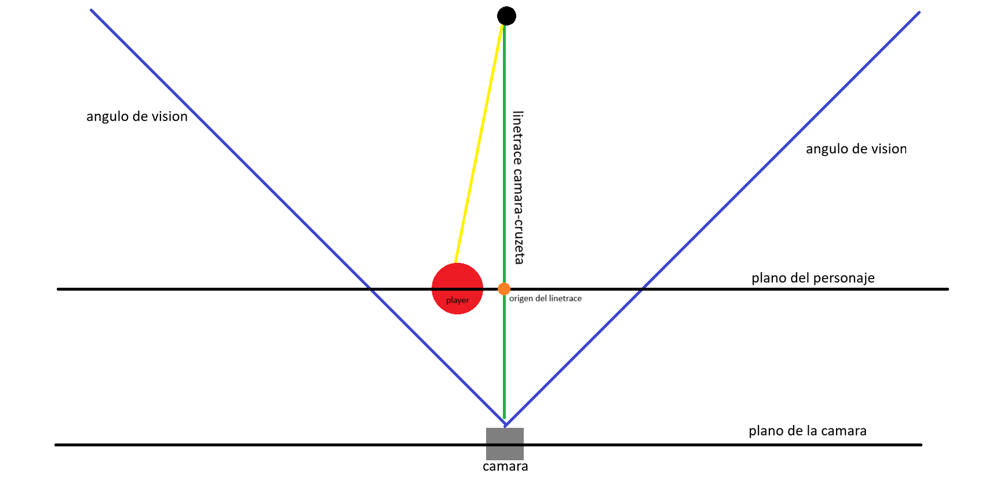

# Motores Gráficos — Alvar Dalda (R2)

He hecho este proyecto en UE5.8 (Blueprints + C++). En este archivo resumo las decisiones que he tomado y por qué, contrastándolas con el temario y el enunciado R2. El vídeo de demostración que pide el enunciado está aquí: [https://youtu.be/jTIpeNR9q0o](https://youtu.be/jTIpeNR9q0o).

---

## Posicionamiento de la cámara

Como el juego es un shooter en tercera persona, he decidido añadir una **cruzeta** en el centro de la pantalla: me parece la forma más clara de saber hacia dónde estoy apuntando.

Con la cámara del temario (T3-P2) el Spring Arm suele ir solo hacia atrás. En esa configuración el personaje queda delante y **tapa** el centro de la mira. Por eso he desplazado la cámara un poco a la derecha (`SocketOffset` en el Spring Arm): el cuerpo queda a un lado, la cruzeta sigue en el centro y puedo ver lo que apunto. El ratón sigue rotando el *Controller* y el brazo hereda esa rotación (`bUsePawnControlRotation`), sin que la cámara rote por su cuenta.

También he activado la colisión del brazo (`bDoCollisionTest`, canal `Camera`): si hay muro o suelo entre el personaje y la cámara, el brazo se acorta y no atraviesa la geometría. El mesh del portal solo bloquea ese canal; así, al salir, si el disco se interpone, la cámara se acerca en lugar de dejarme la pantalla negra.

---

## Disparo: Line Trace

En R1 el temario pedía un proyectil con esfera y físicas que no implementé en su momento. En R2 he pasado directamente al **Line Trace** del tema 5, saltandome esa implementación ya que me ha parecido innecesario mantener las dos cosas a la vez. El rayo ya resuelve el impacto; un proyectil encima solo duplicaría lógica y feedback.

El disparo funciona así: Line Trace → hit → daño o efecto en el punto de impacto, acompañado del montaje de animación de fuego. Para depurar uso la tecla [ **T ]** (rayos y logs); por defecto va desactivada.

### Origen del rayo

Al tener la cámara desplazada respecto al pecho, si disparara en paralelo desde el personaje hacia “donde mira” la cámara, en muros cercanos el impacto **no coincidiría** con la cruzeta. Por eso he optado por un solo rayo sobre el **eje de la cruzeta** (forward de la cámara): el origen es la intersección de ese eje con el plano paralelo a la pantalla que pasa por el pecho. Lo resumo en este esquema:

En verde, el hitscan alineado con la mira; el disparo “en diagonal” desde el hombro lo he descartado.

---

## Enemigos-cubo y color por vida

- Cubos 1×1×1 m, **100 HP**, **20** de daño por impacto → 5 disparos.
- Color **verde → rojo** según la vida que les queda (MID / parámetro Color).
- El spawner mantiene **3**; al morir uno aparece otro en otro sitio.
- El daño lo aplico con `ApplyPointDamage` / `TakeDamage` tras el hit del Line Trace.
